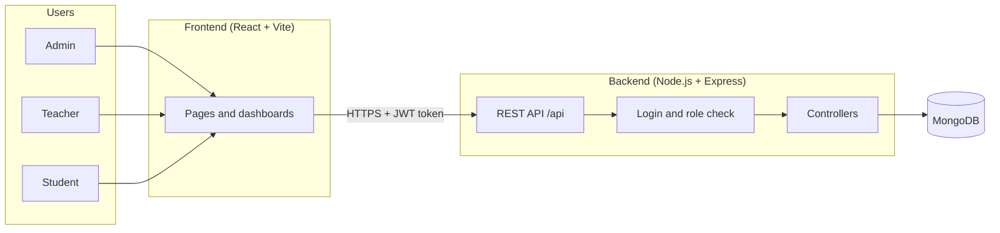
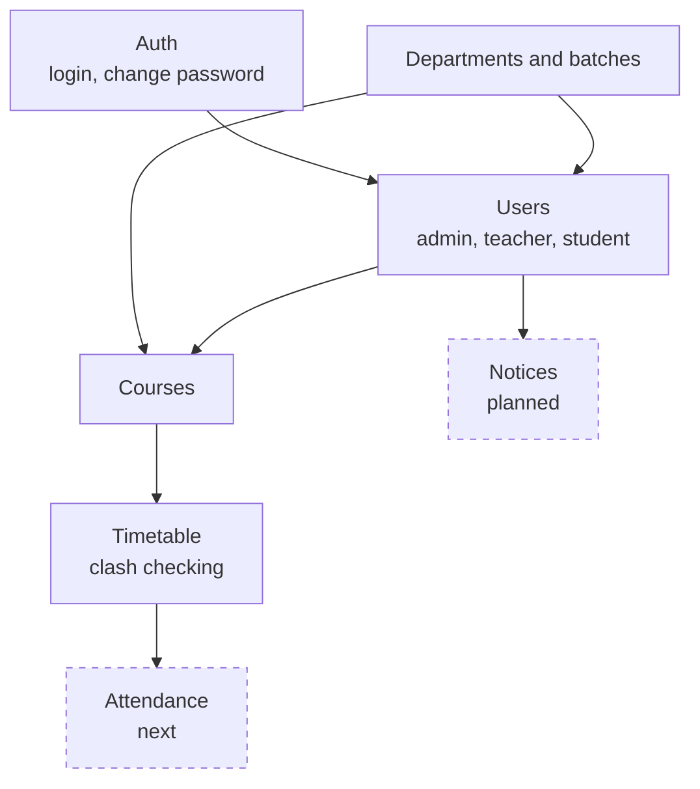
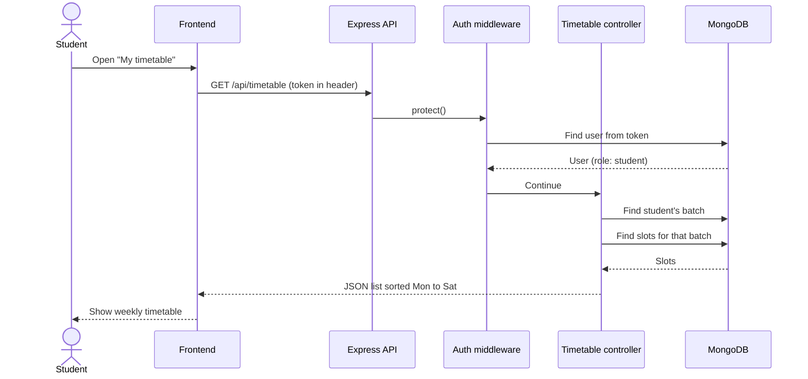
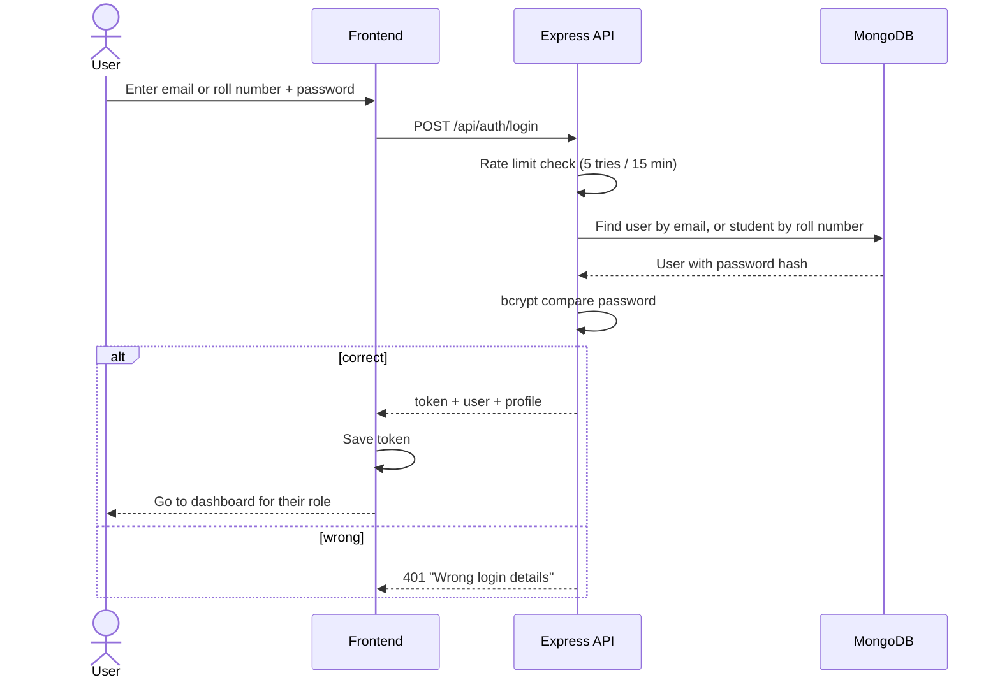
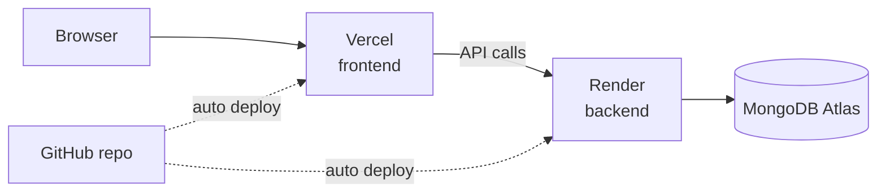

# High Level Design

This page shows the big picture: the parts of Nexus Campus and how they talk to each other.

## 1. System overview

Three types of users open the same React app in their browser. The app calls our Express API, which reads and writes MongoDB.

## 2. Main parts

| Part | Job |
| --- | --- |
| Frontend | Shows pages for each role, stores the login token, calls the API |
| API (Express) | Receives requests, checks login and role, sends back JSON |
| Auth middleware | Checks the JWT token, loads the user, blocks wrong roles |
| Controllers | The actual logic for each feature (users, courses, timetable...) |
| MongoDB | Stores all data |

## 3. Modules

Each module depends on the ones above it. For example, a timetable slot needs a course, and a course needs a batch and a teacher.

## 4. How a request works

Example: a student opens their timetable.

The student never sends their batch. The backend works it out from the token, so a student can't ask for another batch's data.

## 5. Login flow

## 6. Security

- Passwords are stored only as bcrypt hashes, never as plain text
- Every protected route checks the token and the role on the backend
- Students and teachers only get data that belongs to them
- Login is limited to 5 wrong tries per 15 minutes
- New users get a temporary password and must change it
- Secrets live in `.env`, which is never pushed to GitHub

## 7. Deployment (planned)

All three have free tiers, which is enough for a pilot with one batch.
