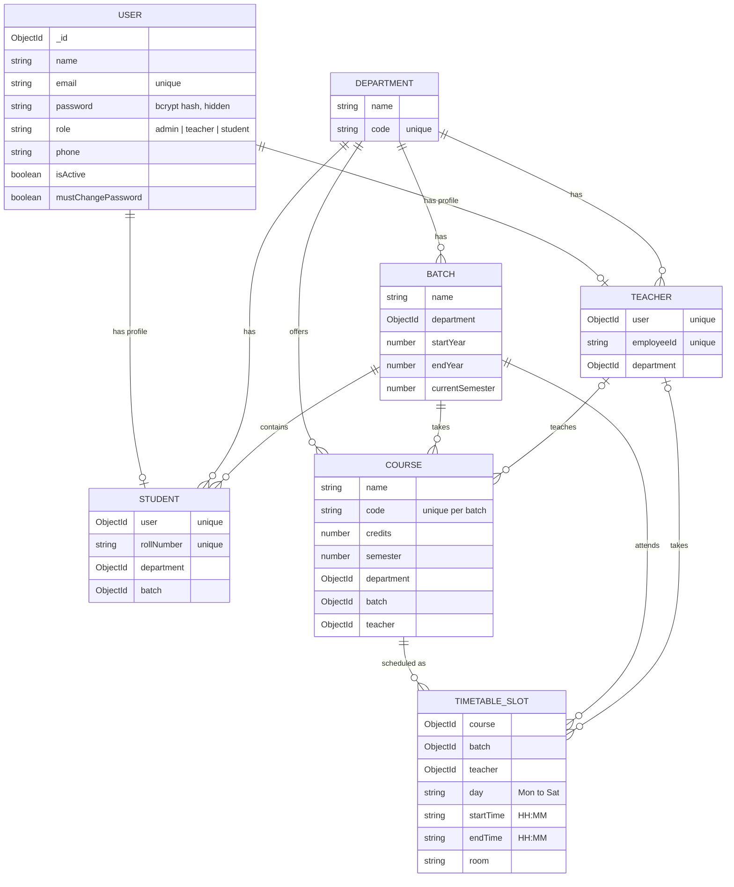
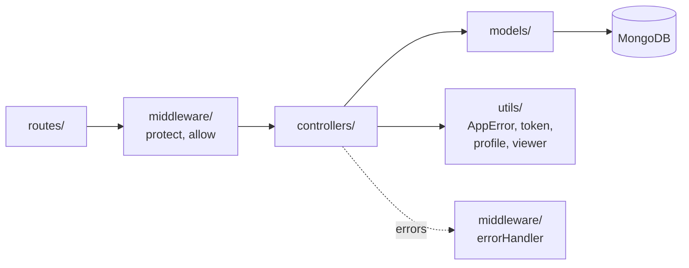
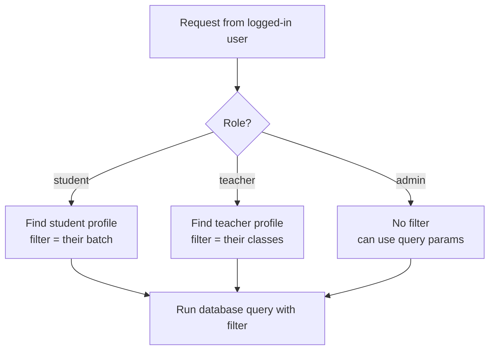
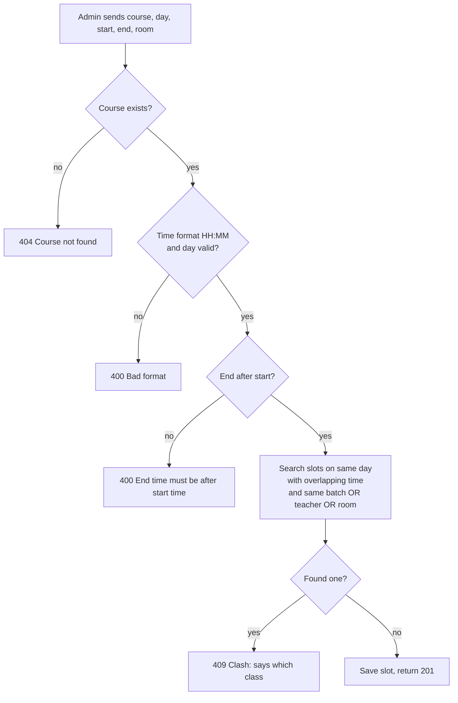
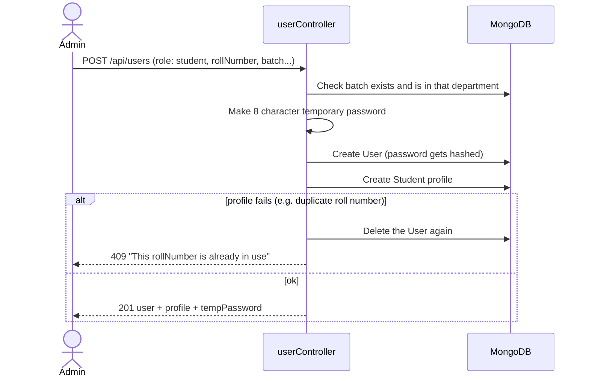

# Low Level Design

This page goes into the details: database collections, how the code is split, and how the main logic works.

## 1. Database schema



**Why `User` is separate from `Student` and `Teacher`:** login works the same for everyone, so email, password and role live in one place. Role-specific details sit in their own collection.

**Why `TimetableSlot` copies `batch` and `teacher` from the course:** the clash check can then search slots directly, without looking up every course first.

### Indexes

| Collection | Index | Why |
| --- | --- | --- |
| users | email (unique) | Fast login, no duplicate emails |
| students | rollNumber (unique) | Login by roll number |
| batches | name + department (unique) | No duplicate batch names in a department |
| courses | code + batch (unique) | Same course can't be added twice to a batch |
| timetableslots | day + batch, day + teacher | Fast clash checks |

## 2. Backend code layout

Every request goes through the same layers.



| Folder | Files | Job |
| --- | --- | --- |
| `routes/` | authRoutes, userRoutes, departmentRoutes, courseRoutes, timetableRoutes | Map URLs to controller functions and attach role checks |
| `middleware/` | auth.js, errorHandler.js | `protect` checks the token, `allow(...roles)` checks the role, `errorHandler` turns errors into clean JSON |
| `controllers/` | authController, userController, departmentController, courseController, timetableController | The logic for each feature |
| `models/` | User, Student, Teacher, Department, Batch, Course, TimetableSlot | Mongoose schemas |
| `utils/` | AppError, token, profile, viewer | Small shared helpers |

### Middleware chain example

`POST /api/timetable` goes through:

```
protect  ->  allow("admin")  ->  createSlot  ->  errorHandler (only if something fails)
```

## 3. Role based data filter

`utils/viewer.js` decides what the logged-in person can see. Courses and timetable both use it.



## 4. Timetable clash check

Two classes clash when **all three** are true:

1. Same day
2. Times overlap: `newStart < oldEnd` and `newEnd > oldStart`
3. They share the same batch, the same teacher, or the same room

Back-to-back classes (9:00 to 10:00, then 10:00 to 11:00) are allowed, because 10:00 is not less than 10:00.



The same check runs when a slot is edited (ignoring the slot itself), and when a course gets a new teacher.

## 5. Create user flow



The temporary password is shown once so the admin can share it. The user must change it on first login.

## 6. Error handling

Controllers throw `new AppError(message, status)`. The error handler turns every error into `{ "message": "..." }`.

| Case | Status | Example message |
| --- | --- | --- |
| No or bad token | 401 | Please log in |
| Wrong role | 403 | You do not have permission to do this |
| Bad input | 400 | End time must be after start time |
| Not found | 404 | Course not found |
| Duplicate or clash | 409 | Clash: this teacher already has a class on Mon 09:00-10:00 (CS201) |
| Too many login tries | 429 | Too many wrong tries. Try again in 15 minutes |
| Anything else | 500 | Something went wrong |
